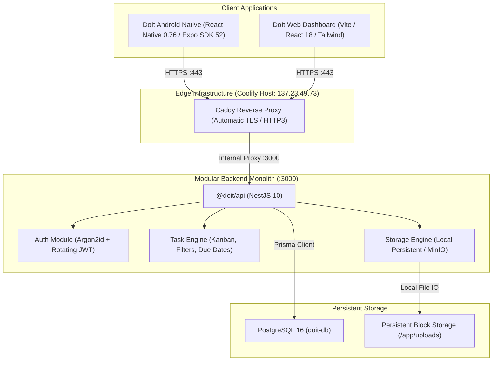

# DoIt — Precision Productivity Platform & Mobile Task Engine

<div align="center">


### *Fast, offline-first personal and team productivity engineered for focus.*

[](https://github.com/kachakaran6/doit/releases)
[](https://github.com/kachakaran6/doit/releases/download/v0.1.0%2B1/DoIt-v0.1.0-build1.apk)
[](https://doit-api.137.23.49.73.sslip.io/api/v1/health)
[](LICENSE)

[**Download Production APK**](https://github.com/kachakaran6/doit/releases/download/v0.1.0%2B1/DoIt-v0.1.0-build1.apk) • [**Live API Health**](https://doit-api.137.23.49.73.sslip.io/api/v1/health) • [**Architecture**](docs/ARCHITECTURE.md) • [**API Docs**](docs/API.md) • [**Release Notes**](release-notes.md)

</div>

---

## 1. Overview

**DoIt** is an enterprise-grade productivity suite combining an offline-first mobile client with a resilient NestJS modular monolith. Designed with inspiration from **Linear**, **Things 3**, and **Notion**, DoIt eliminates clutter in favor of high information density, fluid 60fps micro-interactions, and instant capturing workflows.

### Design Philosophy
- **Restrained Graphite Palette**: Deep `#101113` background, `#17191C` card surfaces, and `#7775D8` indigo accents — no fluorescent gradients or decorative noise.
- **Strict 4-Point Geometry**: Spacing, radii, and typographic line heights conform to predictable mathematical rhythms.
- **Offline Reliability**: Every mutation is optimistic and persists locally before background queue dispatch with exponential backoff retries.

---

## 2. Live Application Showcase

Captured directly from physical hardware running the release APK (`com.samyukt.doit`, v0.1.0+1):

<div align="center">
<table>
  <tr>
    <td align="center" width="25%"><b>Today & Workspaces</b></td>
    <td align="center" width="25%"><b>Task Hierarchy & Kanban</b></td>
    <td align="center" width="25%"><b>Masonry Stickies</b></td>
    <td align="center" width="25%"><b>Preferences & Sync</b></td>
  </tr>
  <tr>
    <td></td>
    <td></td>
    <td></td>
    <td></td>
  </tr>
</table>
</div>

---

## 3. Architecture Specification



---

## 4. Key Features

- **Hierarchical Tasks & Projects**: Organize tasks by workspace, project, priority (`LOW`, `MEDIUM`, `HIGH`, `URGENT`), and custom color-coded labels.
- **Interactive Kanban Boards**: Real-time state transitions between `TODO`, `IN_PROGRESS`, `BLOCKED`, and `DONE`.
- **Masonry Sticky Notes**: 2-column spatial scratchpad for fleeting thoughts, pinned notes, and quick conversions into full tasks.
- **Quick-Capture Audio Notes**: Native audio recording pipeline with background speech-to-text processing.
- **Floating Signature Navbar**: Thumb-accessible pill navigation with an elevated 56dp quick-action hub.
- **Enterprise Security**:
  - Argon2id password hashing (memory cost 65536, time cost 4, parallelism 1).
  - Stateless 15-minute access tokens paired with rotating refresh token families.
  - Granular role hierarchy (`OWNER`, `ADMIN`, `MEMBER`, `VIEWER`).
  - Rate limiting (60 req/min per IP via `@nestjs/throttler`).

---

## 5. Technology Stack

| Layer | Technologies |
| :--- | :--- |
| **Mobile Runtime** | React Native `0.76.7`, Expo SDK `52.0.30`, New Architecture (Fabric + Bridgeless) |
| **Mobile UI** | NativeWind v4, Tailwind CSS, Lucide React Native, React Native Reanimated |
| **Backend Framework** | NestJS `10.4.15`, Express, TypeScript `5.8.2`, Node.js `22-alpine` under `tini` |
| **Database & ORM** | PostgreSQL 16 Alpine, Prisma ORM `5.22.0` |
| **Deployment / CI** | Coolify PaaS, Docker Engine 28, Caddy Docker Proxy, Expo EAS Build |
| **Package Management** | Monorepo via Turborepo, pnpm `11.9.0` workspaces |

---

## 6. Versioning Strategy (`VERSION+BUILD`)

DoIt implements strict SemVer with monotonically increasing build numbers:

$$\text{Format: } \text{MAJOR}.\text{MINOR}.\text{PATCH} + \text{BUILD\_NUMBER}$$

- **Current Release**: `0.1.0+1` (`version: 0.1.0`, `versionCode: 1`)
- **Progression**: `0.1.0+1` $\rightarrow$ `0.1.0+2` $\rightarrow$ `0.1.1+3` $\rightarrow$ `0.2.0+4` $\rightarrow$ `1.0.0+5`
- The Android `versionCode` increments on every build and is never reused.

---

## 7. Trade-offs & Engineering Decisions

### Architectural Strengths
- **Modular Monolith over Microservices**: Drastically lower operational complexity, sub-millisecond in-process module communication, and atomic database transactions.
- **ExFAT & Windows Compatibility**: Monorepo symlinks and package resolution optimized with dedicated postinstall synchronization scripts.
- **Zero-Downtime Rolling Deployments**: Coolify and Caddy coordinate health checks before shifting ingress traffic to new application containers.

### Deliberate Trade-offs
- **Bundled SQLite vs Pure Memory Cache**: The mobile client caches all state in persistent device storage for full offline readiness, which adds a minimal storage footprint (~5MB).
- **Standalone Docker vs Kubernetes**: Docker Compose orchestrated by Coolify provides predictable resource budgeting and simpler maintenance without Kubernetes cluster overhead.

---

## 8. Installation & Quick Start

### 8.1 Android Device Installation
1. Download [**DoIt-v0.1.0-build1.apk**](https://github.com/kachakaran6/doit/releases/download/v0.1.0%2B1/DoIt-v0.1.0-build1.apk).
2. Tap the APK in your downloads and select **Install** (enable unknown sources if prompted).
3. Verify integrity:
   ```powershell
   # Expected Hash
   Get-Content DoIt-v0.1.0-build1.apk.sha256
   # 0FD4BD6ADA5E8FD4F4644922A0708A6DD60A1E01F6D471C70D20641CFF78B44F
   ```

### 8.2 Local Monorepo Development
```bash
# Clone the repository
git clone https://github.com/kachakaran6/doit.git
cd doit

# Install monorepo dependencies
pnpm install

# Start PostgreSQL database (local)
docker compose up -d db

# Run NestJS API backend
pnpm --filter @doit/api dev

# Run Mobile application
pnpm --filter @doit/mobile start
```

---

## 9. Comprehensive Documentation Index

- [Production Deployment Guide](docs/PRODUCTION-DEPLOYMENT.md)
- [System Architecture & Topology](docs/ARCHITECTURE.md)
- [REST API & OpenAPI Contract](docs/API.md)
- [Release Engineering & Versioning Guide](docs/RELEASE-GUIDE.md)
- [Installation & Self-Hosting Guide](docs/INSTALLATION.md)
- [Full Project Changelog](CHANGELOG.md)

---

## 10. License

DoIt is released under the [MIT License](LICENSE).
