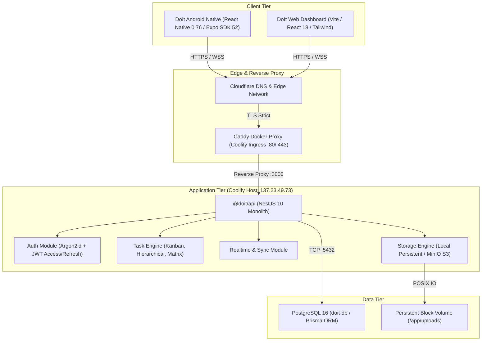
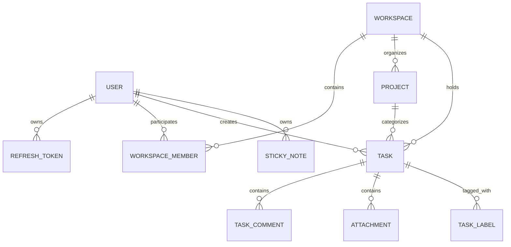

# DoIt Architecture Specification

## 1. System Overview

DoIt is a high-performance, precision productivity and task management platform engineered with an offline-first mobile client, a resilient NestJS modular monolith backend, and automated infrastructure deployment via Coolify and Caddy.

---

## 2. Component Architecture

### 2.1 Mobile Application (`apps/mobile`)
- **Runtime**: React Native `0.76.7`, Expo SDK `52.0.30`, New Architecture (Fabric + Bridgeless) enabled.
- **UI & Design System**: Linear / Things 3 inspired graphite theme (`#101113` background, `#17191C` card surface, `#7775D8` restrained indigo accent).
- **Styling**: NativeWind v4 + Tailwind CSS tokens + Lucide React Native.
- **State & Networking**:
  - Offline-first cache layer with optimistic mutations.
  - Native gesture handler and reanimated spring physics for smooth 60fps interactions.
  - Quick-capture audio notes, gesture navigation, and sticky notes drawer.

### 2.2 Backend API (`apps/api`)
- **Runtime**: Node.js `22-alpine` under `tini` init supervisor for zero-zombie process reaping.
- **Framework**: NestJS 10 modular monolith with express adapter.
- **Database Access**: Prisma ORM 5.22 with pooled connections and PostgreSQL query optimization.
- **Authentication**: Stateless access tokens (15m expiry) paired with cryptographically hashed refresh tokens in PostgreSQL with rotation and device revocation.
- **Security Middleware**:
  - Global Throttler (rate limiting: 60 req/min per IP).
  - Helmet security headers and strict CORS origin validation.
  - Argon2id password hashing (memory cost 65536, time cost 4, parallelism 1).
  - Role-Based Access Control (`WORKSPACE_OWNER`, `ADMIN`, `MEMBER`, `VIEWER`).

### 2.3 Edge & Reverse Proxy
- **Caddy Docker Proxy**: Dynamically observes Docker container lifecycle labels.
- **Automatic TLS**: Zero-configuration Let's Encrypt / Cloudflare Origin CA SSL certificates.
- **HTTP/2 & HTTP/3 (QUIC)** enabled out of the box with automated gzip/zstd compression.

---

## 3. Database Schema Topology

---

## 4. Security & Compliance Boundaries
1. **Network Isolation**: The PostgreSQL container exposes no public ports; communication is restricted to the internal Docker network `coolify`.
2. **Secret Management**: All secrets (`DATABASE_URL`, `JWT_SECRET`, `JWT_REFRESH_SECRET`) are injected as runtime environment variables through Coolify.
3. **Storage Sanitization**: File uploads are verified for MIME magic bytes and UUID-renamed prior to writing to persistent storage.

