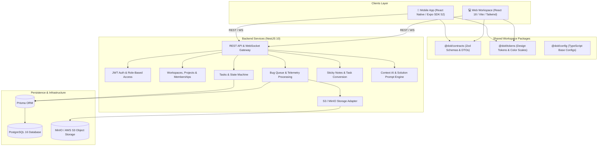

# DoIt — System Architecture

## 1. System Overview

**DoIt** (formerly *Samyukt*) is an enterprise-ready, cross-platform task management, bug tracking, and collaborative workspace platform designed for engineering and product teams. It combines deep native mobile capabilities (floating capture bubble, shake-to-report, accessibility-assisted screenshotting, local/remote voice notes) with a modern web workspace featuring Kanban workflows, unified work triage, and real-time synchronization.

The system is organized as a high-performance TypeScript monorepo orchestrated with **Turborepo** and **pnpm workspaces**.



---

## 2. Monorepo Topology

```
k:/Doit/
├── apps/
│   ├── api/          # Production NestJS REST API & WebSocket server
│   ├── mobile/       # React Native Expo application (Android & iOS)
│   └── web/          # React 18 + Vite SPA workspace client
├── packages/
│   ├── contracts/    # Shared Zod validation schemas, API contracts & types
│   ├── design-tokens/# Shared design tokens, color ramps, typography scales
│   └── config/       # Shared TypeScript configurations
├── infrastructure/   # Container definitions & Coolify deployment manifests
├── docs/             # Consolidated architectural and operational guides
└── scripts/          # Workspace synchronization and utility scripts
```

### Dependency Invariants
* `packages/contracts` has zero runtime dependencies other than `zod`. Both frontend clients (`apps/mobile`, `apps/web`) and the backend (`apps/api`) import shared DTO schemas directly from `@doit/contracts`.
* `packages/design-tokens` provides deterministic color palettes, contrast ratios, and spacing metrics used identically across the web CSS variables and mobile theme constants.
* Applications never import source code directly from sibling applications; all cross-boundary code flows through shared packages.

---

## 3. Backend Architecture (`apps/api`)

The backend is built with **NestJS 10** using a modular, domain-driven structure:

* **Authentication & Authorization**:
  * Dual-token model: short-lived JWT Access Tokens (15m) and secure JWT Refresh Tokens (7d).
  * Role-Based Access Control (RBAC): `OWNER`, `ADMIN`, `MEMBER`, `TESTER`, and `VIEWER` roles enforced via `@Roles()` decorator and `WorkspaceMemberGuard`.
  * Passwords hashed using Argon2id.
* **Database & Persistence**:
  * PostgreSQL 16 managed via **Prisma ORM**.
  * Strict database migrations tracked in `prisma/migrations`.
  * Idempotency keys supported on critical write mutations (e.g. rapid task creation and offline sync replays).
* **Object Storage**:
  * Pluggable `StorageAdapter` interface supporting local disk storage (`LocalStorageAdapter`) for offline testing and S3/MinIO (`S3StorageAdapter`) for production.
  * Presigned upload and download URLs for screenshots, voice recordings, and attachments.
* **Realtime Communication**:
  * WebSocket Gateway powered by `@nestjs/platform-ws` or Socket.IO for workspace-wide task updates, active collaborator presence, and bug alerts.
* **Context AI Engine**:
  * Stores project architecture context and generates diagnostic solution prompts for engineering triage.
  * Secure credential management: personal provider API keys (OpenRouter, OpenAI, Anthropic, Gemini) are encrypted at rest using AES-256-GCM via `AI_CREDENTIALS_KEY`.

---

## 4. Mobile Architecture (`apps/mobile`)

The mobile client is built with **React Native 0.76** and **Expo SDK 52**:

* **Feature-Driven Structure**:
  * Features are cleanly isolated in `src/features/<feature_name>/` (e.g., `auth`, `home`, `tasks`, `bugs`, `stickies`, `capture`, `settings`, `workspace`).
  * Each feature owns its screens, state hooks, and API client adapters.
* **State Management & Offline Synchronization**:
  * Server caching and optimistic UI updates powered by **TanStack React Query v5**.
  * Global UI and session state powered by **Zustand**.
  * **Offline Outbox**: Mutations performed when disconnected are queued in an encrypted SQLite/SecureStore outbox and replay deterministically upon network reconnection.
* **Native Android Services**:
  * **Floating Capture Overlay**: System-level floating action button allowing immediate bug or task reporting over any running app.
  * **Shake-to-Report**: Accelerometer-driven event detector to trigger instant bug capture.
  * **Accessibility Screenshot Helper**: Prominently disclosed `AccessibilityService` that allows capturing the user screen without interrupting active user flows.

---

## 5. Web Workspace Architecture (`apps/web`)

The web client is a single-page application built with **React 18**, **Vite 6**, and **Tailwind CSS**:

* **Full-Canvas Layout**:
  * Dynamically uses screen width up to `1680px` (`PageContainer width="workspace"`), preventing artificial horizontal void or clipped layouts.
  * Responsive collapsible sidebar with keyboard shortcuts (`Ctrl+B`) and clean indicator states.
* **Interactive Kanban Board**:
  * Zero-dependency native HTML5 drag-and-drop board supporting cards across `TODO`, `IN_PROGRESS`, and `DONE`.
  * Optimistic UI cache mutation with automatic rollback and error notification on network failure.
* **Unified All Work Hub (`/work`)**:
  * Consolidates tasks and bug reports into a single scannable view without altering backend schema or conflating bug severity with task priority.
  * Comprehensive filtering by project, status, priority/severity, and sorting.
* **Integrated Diagnostics**:
  * Interactive peek drawer for tasks and bugs.
  * High-resolution screenshot viewer with lightbox zoom and voice note playback.
  * AI solution prompt generator integrating project architecture context.

---

## 6. Security & Compliance Architecture

* **Least-Privilege API Boundaries**: No sensitive database fields (`passwordHash`, `aiKeyCipher`) are ever returned in API response bodies; sanitization is performed in service mappers.
* **Safe Encrypted Secrets**: Personal AI credentials are never written to disk or logs in plaintext. AES-256-GCM provides authenticated ciphertext validation.
* **Google Play Policy Compliance**:
  * All permissions (Microphone, Accessibility, Foreground Service) implement runtime checks, contextual permission explanations, and prominent disclosure dialogs.
