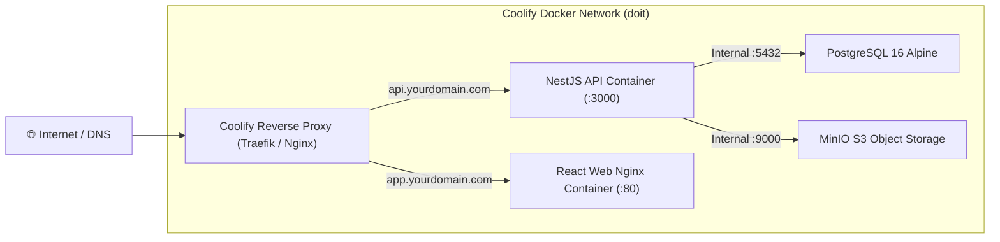

# DoIt — Coolify & Production Deployment Guide

This guide describes how the DoIt backend and web services are deployed and maintained on **Coolify** (or any Docker / Docker Compose host).

---

## 1. Production Architecture on Coolify

The backend infrastructure is containerized and deployed as a unified stack using `docker-compose.coolify.yml`:



---

## 2. Docker Compose Configuration

The authoritative production compose file is [`docker-compose.coolify.yml`](file:///k:/Doit/docker-compose.coolify.yml).

### Services:
1. **`db`**: PostgreSQL 16 Alpine container with persistent named volume `pgdata`.
2. **`minio` & `minio-init`**: MinIO S3 object storage for screenshots, audio notes, and attachments with volume `miniodata`.
3. **`api`**: Production NestJS application built from `docker/api.Dockerfile`.
4. **`web`**: Production web SPA built from `docker/web.Dockerfile` served via Nginx.

---

## 3. Environment Variables Reference

Configure these environment variables in your Coolify application settings:

| Variable | Description | Example / Default |
|---|---|---|
| `NODE_ENV` | Runtime environment | `production` |
| `PORT` | NestJS HTTP listener port | `3000` |
| `DATABASE_URL` | PostgreSQL connection string | `postgresql://doit:SECURE_PASS@db:5432/doit` |
| `JWT_SECRET` | Secret key for signing 15m Access Tokens | `min_32_characters_random_secret` |
| `JWT_REFRESH_SECRET` | Secret key for signing 7d Refresh Tokens | `min_32_characters_random_secret` |
| `AI_CREDENTIALS_KEY` | AES-256-GCM encryption key for user AI keys | `min_16_characters_random_secret` |
| `STORAGE_DRIVER` | Storage provider driver | `s3` |
| `S3_ENDPOINT` | Internal/External S3 endpoint URL | `http://minio:9000` (or `https://s3.amazonaws.com`) |
| `S3_REGION` | S3 region | `auto` (or `us-east-1`) |
| `S3_BUCKET` | S3 bucket name | `doit-uploads` |
| `S3_ACCESS_KEY_ID` | S3 / MinIO access key | `minioadmin` |
| `S3_SECRET_ACCESS_KEY` | S3 / MinIO secret key | `minioadmin_secure_pass` |
| `S3_FORCE_PATH_STYLE` | Path-style bucket access (required for MinIO) | `true` |
| `TRUST_PROXY` | Trust reverse proxy headers (`X-Forwarded-For`) | `1` |

> [!IMPORTANT]
> `AI_CREDENTIALS_KEY` must be set with at least 16 characters in production. If unset, user-submitted AI provider keys cannot be saved, and connection tests will fail.

---

## 4. Deployment Steps in Coolify

1. **Create New Service in Coolify**:
   * Source: **Git Repository** (`https://github.com/kachakaran6/doit.git`).
   * Branch: `main`.
   * Build Pack: **Docker Compose**.
   * Compose File Path: `docker-compose.coolify.yml`.

2. **Configure Environment Variables**:
   * Add all required secrets in the Coolify **Environment Variables** tab.

3. **Configure Domains in Coolify**:
   * **API**: Route port `3000` to your API domain (e.g. `https://api.doit.yourdomain.com`).
   * **Web**: Route port `8080` (or `80`) to your Web domain (e.g. `https://doit.yourdomain.com`).

4. **Database Migrations on Deploy**:
   The `docker/api.Dockerfile` entrypoint automatically executes `prisma migrate deploy` before launching the NestJS process, ensuring your PostgreSQL schema is always synchronized.

5. **Health Checks**:
   * Healthcheck URL: `http://localhost:3000/api/v1/health`
   * Health interval: `15s`, timeout: `5s`, retries: `10`.

---

## 5. Maintenance & Backup

* **PostgreSQL Backup**:
  Back up the named volume `pgdata` or schedule periodic SQL dumps:
  ```bash
  docker compose exec db pg_dump -U doit doit > backup_$(date +%Y%m%d).sql
  ```
* **Logs Inspection**:
  ```bash
  docker compose logs -f api
  ```
